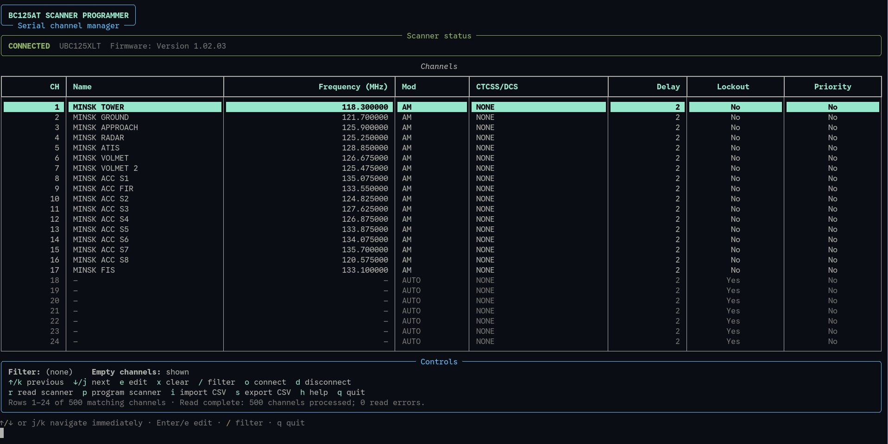

# Uniden BC125XLT Scanner Programmer



A Python terminal user interface (TUI) for managing channels on the Uniden BC125XLT scanner using a serial connection. Built with Rich for a clean, interactive terminal experience.

## Features

Serial port selection — choose a detected serial port using keyboard navigation.

Automatic channel reading — read up to 500 channels after connecting.

Channel management — edit and clear channel entries.

Channel filtering — search channels by name or frequency.

CSV import/export — load frequency lists from CSV files and export channel configurations.

Progress indicators — monitor scanner reading and programming operations.

Rich terminal interface — formatted tables, status panels, and interactive prompts.

## Requirements

Python 3.10 or newer

A compatible Uniden BC125XLT scanner

A suitable USB-to-serial connection or serial interface

The Python packages listed below


## Installation

- Clone the repository:

```
git clone https://github.com/mikalai-dev/bc125xlt-programmer.git
cd bc125xlt-programmer
```

- Install the dependencies:

```
python -m pip install -r requirements.txt
```

- Usage

Start the application:

```python
python main.py
```

On startup, the application displays the serial port selection dialog.

Use the Up and Down arrow keys to select a port.

Press Enter to connect.

The program automatically attempts to read all 500 channels.

Review and manage the channel list in the terminal.

Press Esc in the port selection dialog to skip connecting. You can connect later using the o command.


## CSV Import

The application supports importing channel lists from CSV files.

Example:

```csv
Channel,Name,Frequency_MHz,Modulation,CTCSS_DCS,Delay,Lockout,Priority
1,AIR EMERGENCY,121.500,AM,0,2,No,Yes
2,MINSK TOWER,118.300,AM,0,2,No,No
3,MINSK GROUND,121.700,AM,0,2,No,No
```

The frequency list should be checked for accuracy and compliance with local regulations before use.

## Programming the Scanner

Before programming:

- Connect to the correct serial port.

- Confirm that the imported or edited channels are correct.

- Ensure that you understand that programming can overwrite existing scanner data.

- Use the p command to initiate programming and follow the confirmation prompt.

Warning: Always verify the channel data and test readback before relying on a programmed configuration. Hardware communication has not been verified on every scanner or serial adapter.

## Project Structure

```
bc125xlt_programmer
├── csv
│   └── minsk_airband_frequencies.csv
├── imgs
│   └── screen_1.jpg
├── main.py
├── README.md
└── requirements.txt
```

Adjust the filenames above to match the files in your repository.

## Dependencies

Rich — terminal UI components and progress bars

PySerial — serial communication

readchar — keyboard input

## License

This project is intended to be released under the MIT License. See the LICENSE file for the full license text.

Only describe the project as MIT-licensed after adding the corresponding license file.
